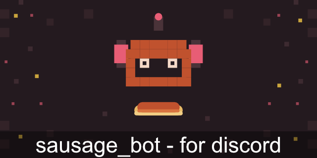

sausage-bot - affectionately known as "pølsa" among its Norwegian users - is a Discord bot with some very specific functions.

## Functions

### Administration (main)

#### Guild administration
- Approve a pending server, admin-guild only (`/guild approve`)
- List servers and their status, admin-guild only (`/guild list`)
- Leave a server, admin-guild only (`/guild leave`)
- Set which guild is the admin guild, admin-guild only (`/guild set_admin_guild`)
- Set the admin channel in the admin guild, admin-guild only (`/guild set_admin_channel`)

#### General commands
- Check latency (`/ping`)
- Kick/ban users (/kick, /ban)
- Delete a number of messages in a channel (`/delete`)
- Make the bot say something in a channel, via the "Say as bot" context menu (right-click any message in that channel)
- Reply to a message as the bot, via the "Reply as bot" context menu (right-click the message to reply to)
- Edit an already-posted bot message, via the "Edit bot message" context menu (right-click the message)
- Show this server's active tasks (`/tasks`)
- List active tasks for every approved server, admin-guild only (`/tasks-global`)
- Show today's estimated YouTube API quota usage, admin-guild only (`/youtube quota`)
- Set language (`/language`)
- Set timezone (`/timezone`)
- Set or create the bot's channel for logs and notifications (`/bot_channel`)
- Change the bot's nickname, avatar, banner or bio on this server (`/profile set`), or reset it (`/profile reset`)
- Show the bot's current version and branch info (`/version`)

#### Developer

- Syncing commands
  - Sync all commands in all guilds (`/sync global`, `!syncglobal`)
  - Sync all commands in active guild (`/sync local`, `!synclocal`)
  - Clear global or local commands (`!clearglobal`, `!clearlocal`)

### Autoevent

Takes links to soccer games on predefined sites, and make them into an event for the server.

Command: `/autoevent`

- Add an event from a match url (nifs, vglive or tv2.no/livesport) (`/autoevent add`)
- Remove a scheduled event, one or all (`/autoevent remove`)
- List all planned events (`/autoevent list`)
- Create a countdown/sync timer for a live event on TV/stream (`/autoevent sync`)
- Announce an event in a specific channel (`/autoevent announce`)

### Dilemmas

Create dilemmas for discussion on the server

Command: `/dilemmas`

- Post a random dilemma (`/dilemmas post`)
- Add a dilemma (`/dilemmas add`)
- Count the number of dilemmas (`/dilemmas count`)

### Poll

Make a simple poll.

Command: `/poll`

- Make a poll, with channel, post time, lock time, text and alternatives (`/poll`)

### Quote

Save and post quotes from the server.

Command: `/quote`

#### Managing quotes
Only available for those with "Manage server" rights

- Add a quote directly from an existing message via the "Add quote" context menu
- Edit a quote (`/quote edit`)
- Delete a quote (`/quote delete`)
- Count the number of quotes (`/quote count`)
- List quotes from quote number or search for a keyword (`/quote post`, `/quote list`)
- Start, stop or restart autoposting of quotes (`/quote autopost start|stop|restart`)
- List, change, add or remove cog settings (`/quote settings list|change|add|remove`)

#### Suggesting/approving quotes
If activated in settings, guild users without "Manage server" rights can suggest a quote via the "Suggest quote" context menu.
Suggested quotes will post in a defined channel, where users with the "Manage server" rights can approve, deny or edit quotes.
with moderator approve/deny flow
Members without "Manage Server" can suggest quotes with the "Suggest
quote" context menu, when `/quote settings change suggest_enabled true`
is set. Suggestions are posted in `suggest_channel` (default
`#quote-suggest`), where a moderator approves or denies them. Setting
`channel` or `suggest_channel` to a channel that does not exist offers to
create it, the same way `/bot_channel` does.

### Manage roles

Manage roles and reaction messages.
Can autoadd role for new users.

Command: `/roles`

#### Roles

- Get info about a role (`/roles info`)
- List roles or emojis (`/roles list`)
- Add a role (`/roles add`)
- Remove a role (`/roles remove`)
- Edit a role (`/roles edit`)

#### Reaction messages

##### Messages

- Add a reaction message (`/roles reaction_add message`)
- Remove a reaction message (`/roles reaction_remove message`)
- List reaction messages, or info about one (`/roles reaction list`)
- Edit a reaction message's text/header (`/roles reaction edit`)
- Sort reaction messages alphabetically (`/roles reaction sort`)
- Sync reaction messages with the database (`/roles reaction sync`)

##### Message roles
- Check and fix the order of reaction messages in a channel (`/roles reaction reorder`)
- Add roles to a reaction message (`/roles reaction_add role`)
- Remove a role from a reaction message (`/roles reaction_remove role`)
- Move a reaction role between two messages (`/roles reaction_move role`)

#### Settings

Settings for roles and reaction messages on the server


##### Message role
- Set a unique role for new users (/roles settings add [Unique role] [discord role]). This is great if you want a certain role to be added to new users to separate them when it comes to moderation or restriction in permissions
- Choose roles not to be included when deciding if the unique role is a user's only role or not (/roles settings add [Not include in total] [discord role])
- Remove a setting (`/roles settings remove`)
- List settings (`/roles settings list`)
- Edit a setting (`/roles settings edit`)

#### Emojis

Manage custom emojis on the server. This is a separate top-level command, not a subcommand of `/roles`.

Command: `/emojis`

- Add an emoji (`/emojis add`)
- Remove an emoji (`/emojis remove`)
- Edit an emoji (`/emojis edit`)
- Get info about an emoji (`/emojis info`)

### RSS

Post RSS-feeds to a channel, both normal RSS-feeds and podcasts from Spotify.

Command: `/rss`

- Start, stop or restart posting - choose feeds, podcasts or both (/rss posting start|stop|restart)
- Add a RSS feed (`/rss add`)
- Remove a RSS feed (`/rss remove`)
- Edit a RSS feed's settings (`/rss edit`)
- Reactivate feed(s) disabled by url errors (`/rss reset_url_errors`)
- Add an allow-/deny-filter for a RSS feed (`/rss filter add`)
- Remove an allow-/deny-filter from a RSS feed (`/rss filter remove`)
- Change a cog setting (`/rss settings change`)
- List all active RSS feeds: normal, added by or filter (`/rss list`)
- Test that a url is a valid RSS/XML feed (`/rss test_feed`)

#### Podcast

Manage Spotify podcasts, posted the same way as RSS feeds. This is a separate top-level command, not a subcommand of `/rss`.

Command: `/podcast`

- Add a Spotify podcast (`/podcast add`)
- Remove a podcast (`/podcast remove`)
- Edit a podcast (`/podcast edit`)
- List all podcasts (`/podcast list`)

### Scrape FCB

(A very specific cog for one of my servers)
Scrape the football website <https://www.fcbarcelona.com> and post news from the website to specific team channels.
Autposting news to specific channels: `first-team`, `femení`, `atlètic`, `juvenil` and `club`.

Command: `/barca`

- Start posting Barca news for this server (`/barca start`)
- Stop posting (`/barca stop`)

### Stats

Get stats to post in a stats channel. Can post stats about the codebase, roles and their members.

Command: `/stats`

- Start posting (`/stats posting start`)
- Stop posting (`/stats posting stop`)
- Restart posting (`/stats posting restart`)
- List settings (`/stats settings list`)
- Change a setting (`/stats settings change`)
- Add a setting (`/stats settings add`)
- Remove a setting (`/stats settings remove`)
- Hide a role from stats (`/stats hide_roles_add`)
- Un-hide a role from stats (`/stats hide_roles_remove`)

### Youtube

Post new videos from given Youtube channels or playlists

Command: `/youtube`

- Start posting (`/youtube posting start`)
- Stop posting (`/youtube posting stop`)
- Restart posting (`/youtube posting restart`)
- Add a YouTube channel or playlist for posting (`/youtube add`)
- Remove a YouTube feed (`/youtube remove`)
- Edit a YouTube feed (`/youtube edit`)
- Reactivate feed(s) disabled by url errors (`/youtube reset_url_errors`)
- Add an allow-/deny-filter for a YouTube feed (`/youtube filter add`)
- Remove an allow-/deny-filter from a YouTube feed (`/youtube filter remove`)
- List all YouTube feeds: normal, added by or filter, channel or playlist (`/youtube list`)

## Multiple servers

sausage-bot can run on several Discord servers at the same time. Each
server gets its own isolated data, settings, language and timezone.

When the bot joins a new server, that server is registered as
**pending** - none of its features (RSS, quotes, roles, stats, etc.)
will work until a bot owner approves it. The server set as
`ADMIN_GUILD_ID` in `.env` is the exception: it's auto-approved and
never needs approving.

To approve a new server:

- The bot posts a notification in `ADMIN_CHANNEL_ID` (in the
  `ADMIN_GUILD_ID` server) whenever it joins a new server
- The bot owner runs `/guild approve guild_id` from that channel
- Use `/guild list` (also from the admin server) to see servers and
  their status

## Set up

Ok, so you want to run a Discord bot?

### Register Discord bot

Follow the instructions on this page on _Creating a Discord Bot Account_: <https://www.pythondiscord.com/pages/guides/python-guides/discordpy/#creating-a-discord-bot-account>

- Navigate to <https://discord.com/developers/applications> and log in.
- Click on New Application.
- Enter the application's name.
- Click on Bot on the left side settings menu.
- Click "Add Bot" and confirm with "Yes, do it!".
- Give your bot a cool name and a nice icon.
- Activate all the intents under "Bot" -> "Privileged Gateway Intents" and click "Save Changes". **Important** Read up on what the specific intents do before you activate them

### Want Spotify branding on your podcast-feeds?

You need to register with Spotify API first:

- Follow the instructions on this page on _Getting started_: <https://developer.spotify.com/documentation/web-api>
- Add "Client ID" and "Client secret" in .env file or as environment argument in docker

### Running the bot

You can chose to invite the bot as is, or host it yourself.

#### Invite the bot

Invite sausage_bot with [this link](https://discord.com/oauth2/authorize?client_id=868976367293849600&permissions=8&integration_type=0&scope=bot+applications.commands).
Wait for activation confirmation before using.

#### Docker-compose

Use the [docker-compose file](https://github.com/geirawsm/sausage_bot/blob/main/docker-compose.yml).

#### Running locally with python

It is recommended to run the bot in a controlled environment, by using `pipenv` or similar services.

- Using the terminal, navigate to the folder where you want to install the bot
- Run `git clone https://github.com/geirawsm/sausage_bot.git`
- `cd` into sausage_bot
- Install `pipenv` if you haven't already
- Run `pipenv shell` to create the python environment and start the shell
- Run `pipenv install` to install dependencies
- Run the bot once to get the `.env` file: `python -m sausage_bot`
- Open `sausage_bot/sausage_bot/data/.env` and add as a minimum these values under the `basic` key:
  - `DISCORD_TOKEN` Get the token from the [Discord Developer portal](https://discord.com/developers/applications) under "Bot", "Build-A-Bot", "TOKEN"
  - `ADMIN_GUILD_ID` The ID of your own/main Discord server - see [Multiple servers](#multiple-servers)
  - `ADMIN_CHANNEL_ID` The ID of a channel in that server for new-server notifications and `/guild approve`
- Invite the bot to your discord server:
  - Again, go back to the [Discord Developer portal](https://discord.com/developers/applications), "OAuth2", "URL Generator".
  - Chose the scope "bot"
  - Chose the minimum needed permission for the bot. Only chose "Administrator" if you're absolutely sure.
  - Click "Copy" on "Generated url", visit that link in a browser.
  - Make sure that the information looks correct, select the server you want it to join, and click "Continue" and confirm the permissions by clicking "Authorize". Your bot should now join the channel in a disconnected state.
  - If this isn't your `ADMIN_GUILD_ID` server, it now needs approval - see [Multiple servers](#multiple-servers)
- Start the bot
  - Go back to the terminal and run `python -m sausage_bot` again. The bot will now be online.

If you run `python -m sausage_bot -h` you can also see all the arguments you can add.

#### Build docker image

`docker build .`

`docker run sausage_bot:latest -v [host path to a data folder]:/data`

---

## Translating (i18n)

### I want to contribute by translating

sausage_bot uses `i18nice` for making text and commands translateable. See the `./sausage_bot/locale` folder to see examples.

- One file per cog/python file, per language
- Filename format is `[filename].[shortcode for language].yml`
- Make a pull request with complete set of files for language

### Hey, does that local flake8 plugin named `flake8-I18N-checker` have anything to do with translating?

I'm glad you asked.

You can use the local flake8 plugin `flake8-I18N-checker` to check your newly created yml-files. Add this to a file in root folder named `.flake8`:

```
[flake8]
exclude =
    ./sausage_bot/flake8-I18N-checker,
    ./sausage_bot/util/i18n.py

[flake8:local-plugins]
extension =
    LC1 = flake8_I18N_checker:I18N_Checker
paths =
    ./sausage_bot/flake8-I18N-checker/
```

Then run the following command in the root folder in a terminal:

`flake8 --select LC`

---

# I want to contribute in other ways

Here's how to help out:

- [Report bugs in issues](https://github.com/geirawsm/sausage_bot/issues/new?title=I found a bug&body=This is a description of the bug I found, how it behaves, and what was the intended behaviour&labels=bug)
- [Come up with awesome ideas (and submit them in issues)](https://github.com/geirawsm/sausage_bot/issues/new?title=I have a great idea&body=This is my description of my great idea&labels=enhancement)
- Make pull requests that solves a problem or an issue

